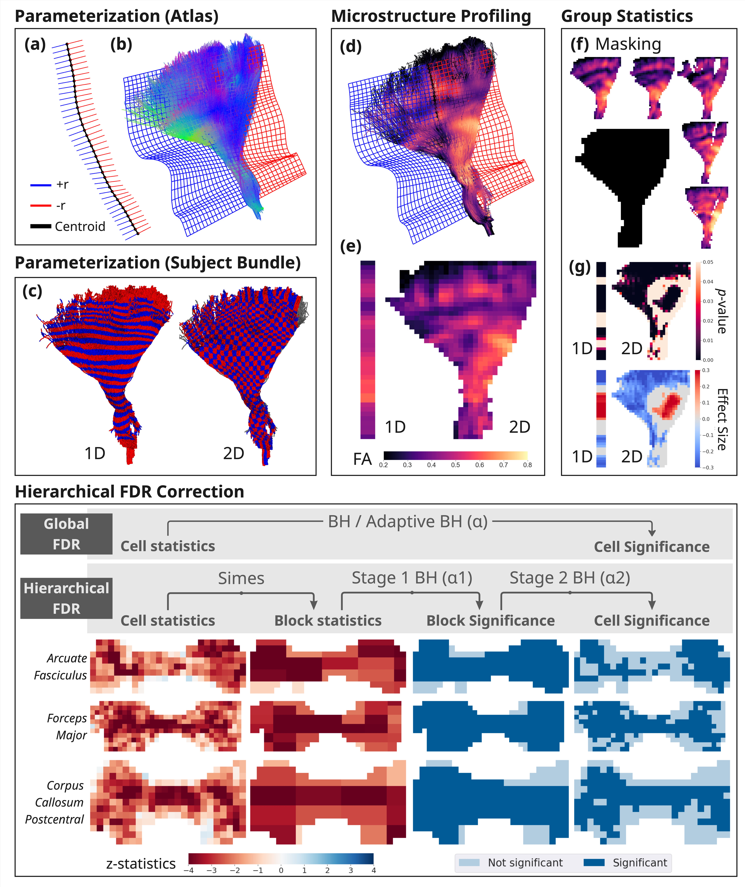

# Spatial Inference for Tractometry (SPECTRA)

**Spatial Inference for Tractometry (SPECTRA)** is a Python framework for white matter tractometry analysis. It extends along-tract (1D) profiling from Bundle Analytics (BUAN) to a 2D parameterization that captures both along-tract and radial variation across bundle cross-sections, defined directly on atlas streamlines. For statistical inference, SPECTRA implements linear mixed modeling via `pymer4` and a hierarchical FDR procedure (hFDR) that improves statistical power and data efficiency compared to the standard BH FDR procedure. 



## Installation

SPECTRA requires Python ≥ 3.11.
```bash
git clone https://github.com/wendyfyx/SPECTRA.git
cd SPECTRA
```

If you only need to compute tract profiles or generate visualizations with (`spectra_profile`, `spectra_viz`), install with [uv](https://docs.astral.sh/uv/):
```bash
uv sync
```

The statistical analysis pipeline (`spectra_lmm_fdr`) requires [`pymer4`](https://github.com/ejolly/pymer4), which depends on R. Because of this R dependency, we recommend installing `pymer4` in a independent conda environment
```bash
# use conda solver
conda create -n spectra_env -c ejolly -c conda-forge python=3.11 pymer4=0.8.2
conda activate spectra_env
# OR use mamba solver (faster)
mamba create -n spectra_env -c ejolly -c conda-forge python=3.11 pymer4=0.8.2
mamba activate spectra_env
```
Then installing SPECTRA with
```bash
uv pip install . 
# OR editable install
uv pip install -e .
```

Verify install
```bash
spectra_lmm_fdr -h
```

> **Note:** `pymer4` is not listed as a package dependency and must be installed separately. SPECTRA will import successfully without it, but calls to the `spectra_lmm_fdr` CLI or the `spectra.tractometry.MultiBundleLM` module will fail at runtime if `pymer4` is not available.